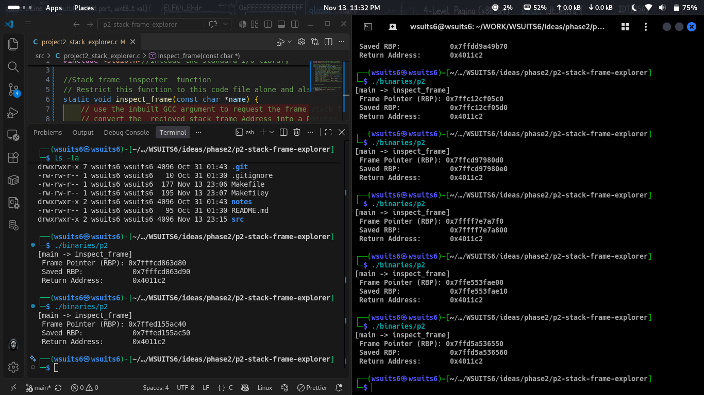

# P2 | Stack Frame Explorer

**A low-level memory exploration project written in C for understanding x86-64 stack frames, function calls, frame pointers, and return addresses.**

> offensive security // burn the path, write your own

---

## Overview

P2 Stack Frame Explorer is a hands-on systems programming project designed to investigate how function calls interact with stack memory on x86-64 Linux systems.

The project explores the internal structure of function stack frames by examining frame pointers, saved frame pointers, return addresses, local variables, function arguments, and raw stack memory.

Using C, GCC, x86-64 architecture concepts, and GDB, the project investigates how function calls operate beneath ordinary C code.

## Project Objectives

- Understand how the x86-64 stack operates.
- Investigate RBP (Base Pointer) and RSP (Stack Pointer).
- Understand how function calls create and destroy stack frames.
- Examine saved frame pointers and return addresses.
- Explore nested function calls and frame relationships.
- Understand the System V AMD64 calling convention.
- Investigate how function arguments are passed through registers and stack memory.
- Inspect raw stack memory using hexadecimal dumps.
- Use GDB to verify observations independently.
- Compare stack layouts under different compiler optimization levels.

## Screenshot



*Terminal environment and project workspace.*

## Technology Stack

| Technology | Purpose |
|---|---|
| C | Main implementation language |
| GCC | Compilation |
| x86-64 | Target architecture |
| Linux | Development environment |
| GDB | Runtime debugging and stack inspection |
| Make | Build automation |
| Assembly | Understanding processor-level operations |

## Project Structure

```text
p2-stack-frame-explorer/
├── assets/
│   └── screenshot.png
├── binaries/
│   └── p2
├── gdb_sessions/
├── notes/
├── src/
│   └── project2_stack_explorer.c
├── Makefile
└── README.md
```

### Directory Responsibilities

- `assets/` - Project screenshots and visual documentation.
- `binaries/` - Compiled executables.
- `gdb_sessions/` - Saved debugging sessions and inspection records.
- `notes/` - Technical explanations, observations, and research notes.
- `src/` - C source code implementing the explorer.
- `Makefile` - Build configuration and compiler instructions.

## Compilation

The project uses GCC with debugging and controlled stack-frame settings.

### Compiler Configuration

```makefile
CC = gcc
CFLAGS = -O0 -g -fno-omit-frame-pointer -fno-stack-protector -no-pie -Wall
```

| Flag | Purpose |
|---|---|
| `-O0` | Disables compiler optimization. |
| `-g` | Includes debugging information. |
| `-fno-omit-frame-pointer` | Requests conventional frame pointers. |
| `-fno-stack-protector` | Disables stack canary protection for controlled experiments. |
| `-no-pie` | Produces a non-PIE executable. |
| `-Wall` | Enables common compiler warnings. |

These settings are intended for controlled experimentation and are not recommended as production security settings.

### Build

```bash
make
```

### Execute

```bash
./binaries/p2
```

## Implementation Roadmap

The project is being developed incrementally.

| Stage | Component | Objective |
|---|---|---|
| 01 | Frame Inspection | Retrieve and display the current frame address, saved RBP, and return address. |
| 02 | Nested Function Calls | Observe how multiple function calls create connected stack frames. |
| 03 | Frame Chain Traversal | Investigate relationships between successive frame pointers. |
| 04 | Stack Memory Dump | Inspect raw memory surrounding a stack frame. |
| 05 | Argument Inspection | Investigate register-based and stack-based argument passing. |
| 06 | GDB Verification | Compare program observations with debugger output. |
| 07 | Optimization Experiments | Compare stack behavior under different compiler configurations. |

*Planned stages are not represented as completed implementations.*

## Current Implementation

### Stage 01: Basic Frame Inspection

The initial implementation uses GCC's `__builtin_frame_address(0)` to retrieve the current function's frame address.

The resulting address is interpreted as a pointer to pointer-sized stack entries.

The program currently investigates:

- Current frame address.
- Saved caller frame pointer.
- Return address.

The implementation uses:

```c
void **fp = (void **)__builtin_frame_address(0);
```

The program then accesses:

```c
fp[0]  // Saved caller frame pointer
fp[1]  // Return address
```

These interpretations apply to the intended conventional frame layout and are not universal guarantees for arbitrary compiler-generated functions.

## Architecture Concepts Being Investigated

### 1. Stack Pointer (RSP)

The RSP register tracks the current stack position.

On x86-64 Linux, the stack conventionally grows towards lower memory addresses.

### 2. Base Pointer (RBP)

RBP can serve as a stable reference point for accessing stack-frame data when the compiler uses a conventional frame-pointer-based layout.

### 3. Saved Frame Pointer

A function can preserve its caller's frame pointer when establishing its own stack frame.

This creates a chain of frame references that can be investigated during debugging.

### 4. Return Address

The x86-64 `CALL` instruction pushes a return address onto the stack. The corresponding `RET` instruction uses that address to resume execution.

### 5. Calling Convention

The project investigates the System V AMD64 ABI, including its integer argument registers:

```text
RDI
RSI
RDX
RCX
R8
R9
```

Additional integer arguments are passed through stack memory according to the calling convention.

## Debugging and Verification

GDB will be used to independently investigate the program's execution state.

Useful commands:

```gdb
break inspect_frame
run
info registers rbp rsp
info frame
bt
x/12gx $rbp-32
disassemble
```

These commands help inspect registers, stack contents, call frames, and generated machine instructions.

## Learning Philosophy

This project is being developed through practical implementation rather than copying a finished solution.

The development process follows:

**Understand → Design → Implement → Compile → Observe → Debug → Verify → Document**

Each stage builds on concepts established in the previous stage.

## Project Status

**Current focus:** Basic stack-frame inspection.

**Next milestone:** Nested function calls and observing how stack frames relate to one another.

---

**Author:** WSUITS6

**Focus:** Systems Programming | Computer Architecture | Memory Internals | Offensive Security Research

**Philosophy:** offensive security // burn the path, write your own

